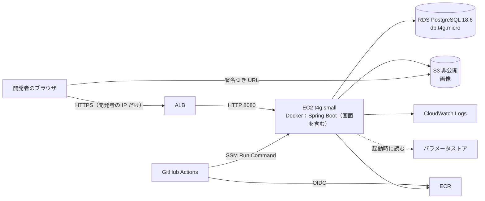

# デプロイ設計書：タイムライン型 SNS（RaiseTimeline）

| 項目 | 内容 |
|---|---|
| 文書番号 | 09 |
| 版数 | 0.1 |
| 作成日 | 2026-10-31 |
| 作成者 | major182 |
| 前提となる文書 | [01 要件定義書](01_requirements.md)、[02 技術選定書](02_tech-stack.md)、[07 ログ設計書](07_logging-design.md) |

学習用のアプリを AWS に置き、動作を確かめて、完成としたら全部消す。そのための構成・費用・手順を書く。アカウント ID・ARN・接続元の IP・ALB の名前はこの文書に書かない（値の確かめ方は各章を参照）。

## 1. 決めたこと

| 項目 | 決定 | 理由 |
|---|---|---|
| 稼働の期間 | 作ってから**長くても 3 日**。完成としたら `terraform destroy` で消す | 費用を抑える（C-03）。使うのは開発者 1 人 |
| HTTPS の証明書 | **自己署名の証明書**を ACM に取り込み、ALB に付ける（Q-02） | Route 53 のドメイン登録料にはクレジットを使えない。HTTPS・HTTP からの転送・Cookie の `Secure` は本番と同じ形で確かめられる。ブラウザの警告は受け入れる |
| 接続できる人 | ALB のセキュリティグループで、**開発者の IP だけ**を許す | 公開の範囲を最小にする。自己署名なので、一般の人に使わせる形ではない |
| EC2 の台数 | 普段は 1 台。NF-AV-02 の確認のときだけ 2 台（Q-06） | 費用を抑える |
| ログ | CloudWatch Logs だけ。Datadog は使わない | 3 日の確認には足りる |
| 性能テスト | AWS では行わない | 手元で確かめ済み（08）。費用が増える |

## 2. 構成

| 資源 | 内容 |
|---|---|
| VPC | 東京リージョン。公開サブネット 2 つ（ALB・EC2）、非公開サブネット 2 つ（RDS）。NAT ゲートウェイは費用が大きいので使わず、EC2 は公開サブネットに置く |
| セキュリティグループ | ALB：443・80 を開発者の IP だけ。EC2：8080 を ALB からだけ（SSH は開けない。NF-SE-08）。RDS：5432 を EC2 からだけ |
| ALB | 443 で証明書を使い EC2 へ。80 は 443 へ転送（NF-SE-01）。ヘルスチェックは `/actuator/health` |
| EC2 | Amazon Linux 2023（ARM）。IAM ロールで S3・ECR・パラメータストア・CloudWatch Logs・SSM に接続する。鍵は置かない |
| RDS | 1 台。公開しない。自動バックアップ 1 日（NF-AV-03。無料プランの上限も 1 日）。消すときに最終のスナップショットは取らない |
| S3 | 非公開。すべての公開アクセスをブロック。画像は署名つき URL（NF-SE-06）で見せる |

アプリはコンテナ 1 つで動かす。画面（`vite build` の結果）は Spring Boot の静的ファイルとしてイメージに入れる（技術選定書 4）。DB の構造は起動時に Flyway が反映する（NF-MA-02）。

## 3. 費用

金額は USD。EC2 は 2026-10-31 に AWS の料金 API で確かめた東京リージョンの単価。ほかは概算で、構築の前に確かめる。

| 項目 | 単価 | 3 日（72 時間） |
|---|---|---|
| EC2 t4g.small | $0.0216／時 | $1.6 |
| ALB | 約 $0.025／時 + 利用量 | 約 $1.9 |
| RDS db.t4g.micro | 約 $0.03／時 | 約 $2.2 |
| 公開 IPv4（EC2 1・ALB 2） | $0.005／時 × 3 | $1.1 |
| ストレージ・S3・ECR・ログ | ― | 約 $0.5 |
| **合計** | | **約 $7** |

クレジットの残高は $158.98、期限は 2027-03-27（2026-10-31 に `aws freetier get-account-plan-state` で確認）。アカウントは無料プラン。予算アラートとコスト異常検出はアカウント共通のものを使い、Terraform では作らず、消さない。

## 4. 秘密情報と設定値

| 値 | 置き場所 | 備考 |
|---|---|---|
| `JWT_SECRET` | パラメータストア（SecureString） | 256 ビット以上のランダムな値 |
| DB のパスワード | パラメータストア（SecureString） | ランダムに作る |
| 証明書の秘密鍵 | 手元の `.gitignore` の対象のフォルダ。ACM へ取り込んだら消す | Terraform に渡さない（`tfstate` に鍵が入るため）。CLI で ACM に取り込み、ARN を `terraform.tfvars` で渡す |
| 開発者の IP、証明書の ARN | `terraform.tfvars`（コミットしない） | IP は `curl https://checkip.amazonaws.com` で確かめる。変わったら直して `apply` |
| `*.tfstate`・`*.tfvars`・`*.pem` | `.gitignore` に入れる | コミットの前に `git status` で確かめる |

アプリに渡す環境変数：`DB_URL`・`DB_USER`・`DB_PASSWORD`・`JWT_SECRET`・`STORAGE_TYPE=s3`・`S3_BUCKET`・`APP_ENV=prod`・`APP_VERSION`。

## 5. 手順

1. 証明書を作り ACM に取り込む（ALB の DNS 名は作るまで分からないので、仮の名前で作る。自己署名なので警告は名前によらず出る）
2. `terraform apply` で ECR を作り、イメージを置く
3. `terraform apply` で残りを作る
4. 次の確認を行う

### 確認すること

| 観点 | 内容 |
|---|---|
| 通信 | HTTP が HTTPS へ転送される。開発者の IP 以外からはつながらない |
| 認証 | 登録・ログイン・再読み込み後もログインのまま（Cookie の `Secure`）・ログアウト |
| 機能 | 投稿・いいね・コメント・フォロー・タイムライン |
| 画像 | S3 に保存され、署名つき URL で見える。CSP で止められない |
| ログ | CloudWatch Logs に JSON のログが出る |
| 2 台 | EC2 を 2 台にしてもログインが保たれる（NF-AV-02） |

## 6. 自動デプロイ

`main` へのマージの後に GitHub Actions が動く。OIDC で AWS につなぎ（鍵を置かない）、ARM のイメージを作って ECR に置き、SSM Run Command で EC2 のコンテナを入れ替える。ログに出る識別子は `::add-mask::` で伏せる。ワークフローは、AWS の環境がないときに失敗しないよう、リポジトリの変数で有効にしたときだけ動かす。

## 7. 片付け

1. `terraform destroy` で全部消す（S3 の中身も含む）
2. ACM に取り込んだ証明書を消す。手元の鍵も消す
3. EC2・RDS・ALB・EIP・S3・ECR・パラメータの消し残しが 0 件であることを CLI で確かめる
4. GitHub の変数・Secret を消す
5. 予算アラートとコスト異常検出は**残す**

## 8. 改訂履歴

| 版数 | 日付 | 内容 |
|---|---|---|
| 0.1 | 2026-10-31 | 初版（#98） |
