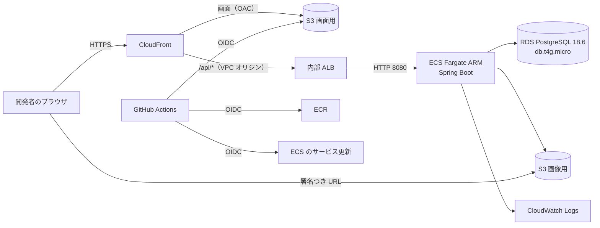

# デプロイ設計書：タイムライン型 SNS（RaiseTimeline）

| 項目 | 内容 |
|---|---|
| 文書番号 | 09 |
| 版数 | 0.3 |
| 作成日 | 2026-10-31 |
| 作成者 | major182 |
| 前提となる文書 | [01 要件定義書](01_requirements.md)、[02 技術選定書](02_tech-stack.md)、[07 ログ設計書](07_logging-design.md) |

学習用のアプリを AWS に置き、動作を確かめて、完成としたら全部消す。そのための構成・費用・手順を書く。アカウント ID・ARN・接続元の IP・CloudFront のドメイン名はこの文書に書かない（値の確かめ方は各章を参照）。

## 1. 決めたこと

| 項目 | 決定 | 理由 |
|---|---|---|
| 構成 | CloudFront + S3（画面）、内部 ALB + ECS Fargate（API）、RDS。EC2 は使わない | 利用者の指定（C-02） |
| 稼働の期間 | 作ってから**長くても 3 日**。完成としたら `terraform destroy` で消す | 費用を抑える（C-03）。使うのは開発者 1 人 |
| HTTPS | CloudFront の標準ドメイン `*.cloudfront.net` と、その証明書を使う（Q-02） | 無料で正式な証明書が付き、独自ドメインが要らない。Route 53 の登録料にはクレジットを使えない |
| 接続できる人 | CloudFront Functions で、**開発者の IP だけ**を通す | WAF は月額がかかる。公開の範囲を最小にする |
| ALB の置き場所 | 内部 ALB を CloudFront の VPC オリジンでつなぐ | Fargate のタスクは IP が変わるので、固定の入口が要る。インターネットから直接つながらない |
| タスクの数 | 普段は 1 つ。NF-AV-02 の確認のときだけ 2 つ（Q-06） | 費用を抑える |
| ログ | CloudWatch Logs だけ。Datadog は使わない | 3 日の確認には足りる |
| 性能テスト | AWS では行わない | 手元で確かめ済み（08）。費用が増える |

## 2. 構成

| 資源 | 内容 |
|---|---|
| VPC | 東京リージョン。公開サブネット 2 つ（Fargate）、非公開サブネット 2 つ（内部 ALB・RDS）。NAT ゲートウェイは費用が大きいので使わない |
| セキュリティグループ | ALB：80 を CloudFront の VPC オリジンからだけ。Fargate：8080 を ALB からだけ。RDS：5432 を Fargate からだけ |
| CloudFront | HTTP は HTTPS へ転送。`/api/*` はキャッシュせず、Cookie・Authorization などをすべて ALB へ渡す。`/assets/*` は長くキャッシュし、`index.html` はキャッシュしない。最大 21MB のアップロードが通ることを確かめる |
| CloudFront Functions | 接続元の IP の判定と、画面の URL の `index.html` への書き換え |
| レスポンスヘッダーポリシー | CSP などを付ける（技術選定書 S-03・S-07）。`img-src` に画像用バケットのオリジンを足す |
| ALB | ヘルスチェックは `/actuator/health` |
| ECS | Fargate、ARM、0.5 vCPU・1GB。公開 IP を持つ（ECR・S3・パラメータストアへの接続のため）が、受ける通信は ALB からだけ。タスクロールで S3 に接続し、鍵は置かない |
| RDS | 1 台。公開しない。自動バックアップ 1 日（NF-AV-03。無料プランの上限も 1 日）。消すときに最終のスナップショットは取らない |
| S3 | 画面用と画像用の 2 つ。どちらも公開アクセスをブロック。画面用は OAC で CloudFront からだけ読める。画像は署名つき URL（NF-SE-06） |

DB の構造は起動時に Flyway が反映する（NF-MA-02）。Spring Boot の画面の配信（`SpaConfig`）は手元の性能テストで使うので残すが、本番のイメージには画面を入れない。CSP の値は `SecurityConfig` と Terraform で 2 か所になるので、変えるときは両方を直す。

## 3. 費用

金額は USD。概算で、構築の前に AWS の料金 API で確かめる。

| 項目 | 単価 | 3 日（72 時間） |
|---|---|---|
| Fargate ARM 0.5 vCPU・1GB（料金 API で確認） | $0.0247／時 | $1.8 |
| ALB | 約 $0.025／時 + 利用量 | 約 $1.9 |
| RDS db.t4g.micro | 約 $0.03／時 | 約 $2.2 |
| 公開 IPv4（Fargate 1） | $0.005／時 | $0.4 |
| CloudFront・S3・ECR・ログ・ストレージ | ― | 約 $1 |
| **合計** | | **約 $7〜10** |

クレジットの残高は $158.98、期限は 2027-03-27（2026-10-31 に `aws freetier get-account-plan-state` で確認）。アカウントは無料プラン。使えるサービスの制限は `terraform plan` の前に確かめる。予算アラートとコスト異常検出はアカウント共通のものを使い、Terraform では作らず、消さない。

## 4. 秘密情報と設定値

| 値 | 置き場所 | 備考 |
|---|---|---|
| `JWT_SECRET` | パラメータストア（SecureString） | 256 ビット以上のランダムな値。タスク定義の `secrets` で渡す |
| DB のパスワード | パラメータストア（SecureString） | ランダムに作る。同上 |
| 開発者の IP | `terraform.tfvars`（コミットしない） | `curl https://checkip.amazonaws.com` で確かめる。変わったら直して `apply` |
| `*.tfstate`・`*.tfvars` | `.gitignore` に入れる | コミットの前に `git status` で確かめる |

アプリに渡す環境変数：`DB_URL`・`DB_USER`・`DB_PASSWORD`・`JWT_SECRET`・`S3_BUCKET`・`APP_ENV=prod`・`APP_VERSION`。`AWS_REGION` と認証情報は Fargate が渡す。`STORAGE_TYPE=s3` はイメージ（`backend/Dockerfile`）で固定するので、ローカルの保存先で動くことはない。`S3_BUCKET` がなければ起動しない。

## 5. 手順

イメージの確認は `node scripts/image-check.ts`（ビルド・`S3_BUCKET` がないと起動しないこと・Flyway・ヘルスチェック・画面が入っていないこと。CI の `image` ジョブでも動く）。

1. `infra/terraform` で `terraform apply -target=aws_ecr_repository.api` を実行して ECR を作り、ARM のイメージに `latest` を付けて置く
2. `terraform apply` で残りを作る
3. 画面をビルドして S3 に置く
4. 次の確認を行う

### 確認すること

| 観点 | 内容 |
|---|---|
| 通信 | HTTP が HTTPS へ転送される。開発者の IP 以外は 403 になる。ALB に外から直接つながらない |
| 画面 | `/posts/1` を直接開いても画面が出る。API の 404 は JSON のまま |
| 認証 | 登録・ログイン・再読み込み後もログインのまま（Cookie の `Secure`）・ログアウト |
| 機能 | 投稿・いいね・コメント・フォロー・タイムライン |
| 画像 | S3 に保存され、署名つき URL で見える。CSP で止められない |
| ログ | CloudWatch Logs に JSON のログが出て、`network.client.ip` が開発者の IP になる |
| 2 タスク | タスクを 2 つにしてもログインが保たれる（NF-AV-02） |

## 6. 自動デプロイ

`main` へのマージの後に GitHub Actions が動き、OIDC で AWS につなぐ（鍵を置かない）。ログに出る識別子は `::add-mask::` で伏せる。AWS の環境がないときに失敗しないよう、リポジトリの変数で有効にしたときだけ動かす。

| 系統 | 流れ |
|---|---|
| API | ARM のイメージを作って ECR に置く → ECS のサービスを更新する |
| 画面 | `vite build` → `s3 sync` → CloudFront の `index.html` のキャッシュを消す |

## 7. 片付け

1. `terraform destroy` で全部消す（S3 の中身も含む）
2. CloudFront・ECS・ALB・RDS・S3・ECR・パラメータの消し残しが 0 件であることを CLI で確かめる
3. GitHub の変数・Secret を消す
4. 予算アラートとコスト異常検出は**残す**

## 8. 改訂履歴

| 版数 | 日付 | 内容 |
|---|---|---|
| 0.1 | 2026-10-31 | 初版（#98）。構成は CloudFront・S3・ALB・ECS Fargate・RDS |
| 0.2 | 2026-10-31 | 本番イメージと確認の方法を追記（#100） |
| 0.3 | 2026-10-31 | Terraform の手順と Fargate の単価を追記（#102） |
